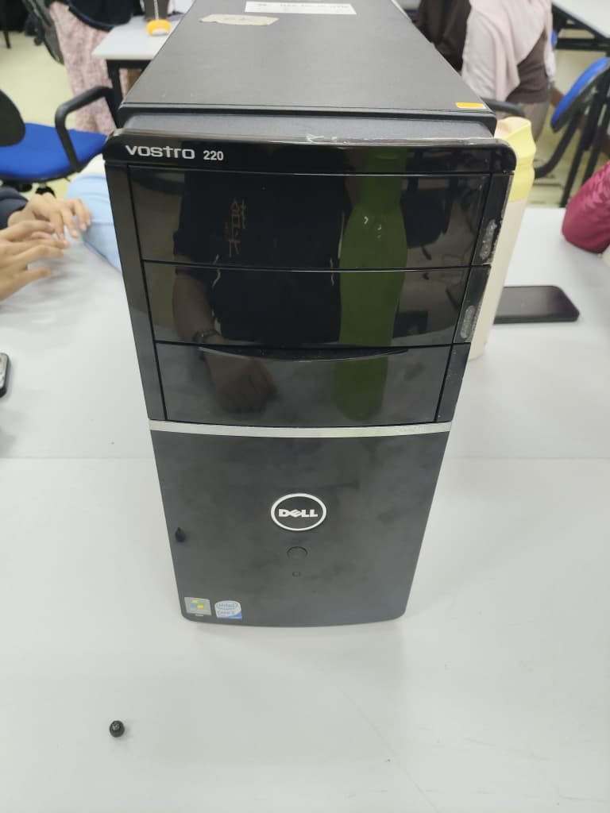
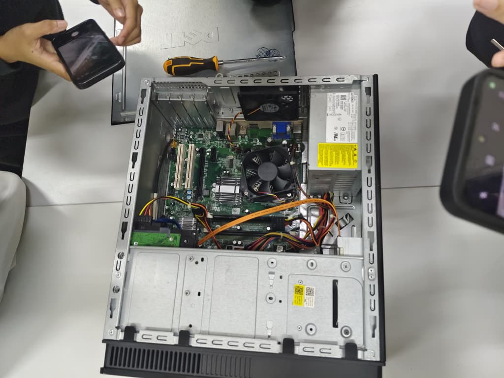
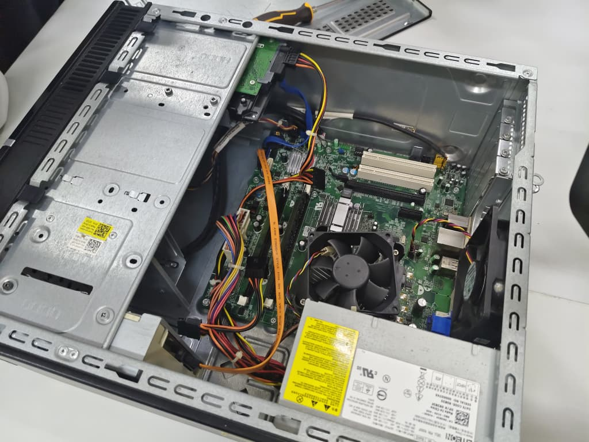
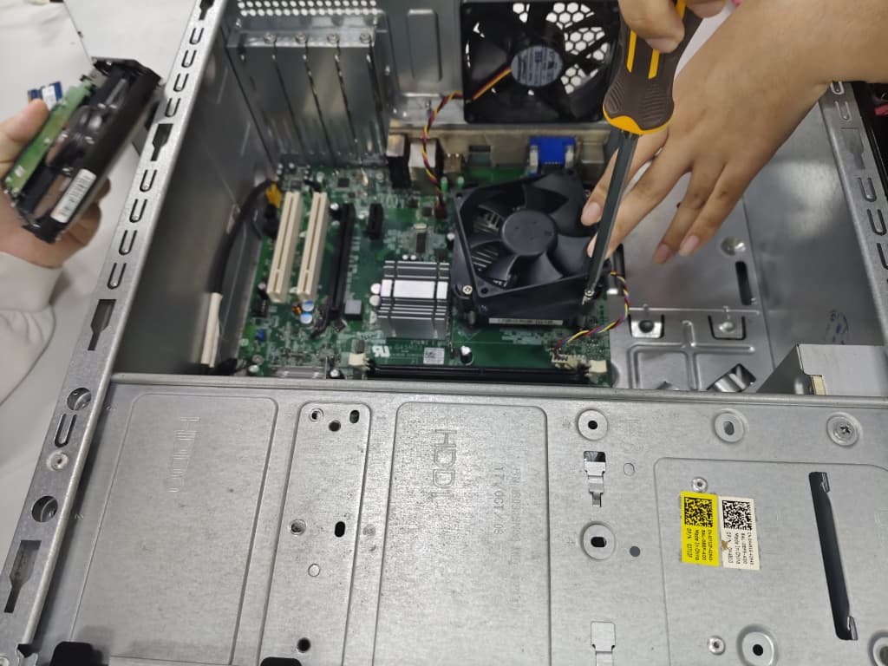

# SECP1513-PC-Assemble
Pc Assemble Lab and Documentation
## Session Photos
- **Dell Vostro 220 Desktp Overview:** 
- **Internal Components Inspection:** 
- **Motherboard and Wiring Setup:** 
- **Component Disassembly:** 

## Activity Summary
During this practical session, our team hands-on inspected and worked on a desktop computer system (Dell Vostro 220)
The main activities included:
1.**External & Internal Inspection:** Examining the computer casing, power supply unit (PSU), wiring, and internal cooling fans.
2.**Motherboard Layout & Component Identification:** Identifying key components such as the CPU heatsink/fan assembly, RAM slots, expansion slots (PCI/PCIe), and SATA data/power connectors.
3.**Hardware Maintenance Practice:** Practicing safe tool handling, loosening screws, and safely detaching/re-attaching internal components like storage drives and cooling systems.

## Reflection
- **What I Learned:** This session bridged the gap between theoretical knowledge and practical hardware application. Seeing the physical layout of a motherboard, power supply unit (PSU), and component placement greatly enhanced my understanding of hardware of computer.
- **Challenges Faced:** Handling internal screws and navigating tight spaces around the CPU cooler and wiring required high precision and patience to avoid damaging sensitive components.
